# UniChrist: Relational Database Design, ER Model & BCNF Normalization Document

### DBMS Project (BCA381-4) — Course Outcome CO1 & CO2 Submission

**CHRIST (Deemed to be University) — Bangalore Yeshwanthpur Campus**  
**Department of Computer Science | Class: 4BCA-B | Academic Year: 2025–2029**

**Team Members:**

1. **Mayank Raj Gupta** (2543115) — _Team Lead / Backend & Database Architect_
2. **Sonti Sri Lakshmi Aslesha** (2543140) — _Core Developer & Schema Analyst_
3. **Aadiya Naresh** (2543163) — _System Analyst, UI/UX & Integration Specialist_  
   **Project Guide:** **Dr Hemanth K S**

---

## 1. Entity-Relationship (ER) Conceptual Architecture

```mermaid
erDiagram
    USERS ||--o{ STUDENTS : "specializes as"
    USERS ||--o{ FACULTIES : "specializes as"
    USERS ||--o{ CAFETERIA_ORDERS : "places"
    USERS ||--o{ STORE_ORDERS : "purchases"
    USERS ||--o{ MEDICAL_VISITS : "attends"
    USERS ||--o{ LOST_FOUND_ITEMS : "reports"
    USERS ||--o{ LIBRARY_CIRCULATION : "borrows"
    USERS ||--o{ GRIEVANCES : "lodges"

    SCHOOLS ||--|{ DEPARTMENTS : "contains"
    DEPARTMENTS ||--o{ STUDENTS : "enrolls"
    DEPARTMENTS ||--o{ FACULTIES : "employs"

    CAMPUS_BLOCKS ||--|{ CAMPUS_ROOMS : "houses"
    CAMPUS_BLOCKS ||--o{ PARKING_SLOTS : "provides"

    CAMPUS_ROOMS ||--o{ BIOMETRIC_CHECKPOINTS : "installed at"
    CAMPUS_ROOMS ||--o{ GRIEVANCES : "located at"
    CAMPUS_ROOMS ||--o{ CAMPUS_EVENTS : "hosts"

    FACULTIES ||--o{ TEACHER_PRESENCE_LOGS : "generates"
    BIOMETRIC_CHECKPOINTS ||--o{ TEACHER_PRESENCE_LOGS : "records"
    FACULTIES ||--|| TEACHER_CURRENT_STATUS : "current state"

    CAFETERIA_VENDORS ||--|{ CAFETERIA_ITEMS : "offers"
    CAFETERIA_ORDERS ||--|{ CAFETERIA_ORDER_ITEMS : "contains"
    CAFETERIA_ITEMS ||--o{ CAFETERIA_ORDER_ITEMS : "ordered in"

    STORE_CATEGORIES ||--|{ STORE_INVENTORY : "classifies"
    STORE_ORDERS ||--|{ STORE_ORDER_ITEMS : "contains"
    STORE_INVENTORY ||--o{ STORE_ORDER_ITEMS : "ordered in"

    BOOK_CATEGORIES ||--|{ LIBRARY_BOOKS : "categorizes"
    LIBRARY_BOOKS ||--o{ LIBRARY_CIRCULATION : "issued in"

    STUDENT_CLUBS ||--o{ CLUB_MEMBERSHIPS : "enrolled in"
    STUDENTS ||--o{ CLUB_MEMBERSHIPS : "joins"
    STUDENT_CLUBS ||--o{ CAMPUS_EVENTS : "organizes"
    CAMPUS_EVENTS ||--o{ EVENT_REGISTRATIONS : "has"
    USERS ||--o{ EVENT_REGISTRATIONS : "registers for"
```



---

## 2. Formal Normalization Proof (1NF to BCNF)

To ensure high performance, eliminate data redundancies, and avoid insertion, deletion, and update anomalies, all core tables in **UniChrist** were rigorously normalized through successive normal forms up to **Boyce-Codd Normal Form (BCNF)**.

### Case Study 1: Faculty Biometric Presence Tracking Schema

- **Initial Unnormalized Form (UNF):**
  `Faculty_Log_Raw(faculty_reg_no, faculty_name, dept_name, hod_name, block_name, room_number, scanner_serial, scan_time, status)`
  - _Anomalies in UNF:_
    - Redundant duplication of department, HOD name, and block names across every scan log.
    - Deletion anomaly: Deleting all scan logs would erase the record of rooms or departments.
    - Insertion anomaly: Cannot add a new faculty member who hasn't scanned yet.

- **First Normal Form (1NF):**
  - All attributes are atomic (no repeating groups, multi-valued attributes, or comma-separated values).
  - Primary Key candidate defined: `{faculty_id, scan_timestamp}`.

- **Second Normal Form (2NF):**
  - Satisfies 1NF.
  - Eliminates **Partial Functional Dependencies** where non-key attributes depend on only part of a composite candidate key.
  - In UNF: `faculty_id -> {faculty_name, dept_name, designation}`, which only depends on `faculty_id`, not `scan_timestamp`.
  - Decomposed into:
    - `Faculties(faculty_id, user_id, dept_id, designation)`
    - `Biometric_Checkpoints(checkpoint_id, room_id, checkpoint_type, scanner_serial)`
    - `Teacher_Presence_Logs(log_id, faculty_id, checkpoint_id, timestamp_scanned, logged_status)`

- **Third Normal Form (3NF):**
  - Satisfies 2NF.
  - Eliminates **Transitive Functional Dependencies** ($X 
ightarrow Y$ and $Y 
ightarrow Z$).
  - In the room/building relation: `room_id -> block_id` and `block_id -> {block_name, total_floors}`.
  - Non-prime attribute `block_name` transitively depended on candidate key `room_id`.
  - Decomposed into separate atomic tables:
    - `Campus_Blocks(block_id, block_code, block_name, total_floors)`
    - `Campus_Rooms(room_id, block_id, room_number, floor_number, room_type)`

- **Boyce-Codd Normal Form (BCNF):**
  - A table is in BCNF if and only if for every non-trivial functional dependency $X 
ightarrow Y$, $X$ is a **Superkey**.
  - Evaluating `Teacher_Current_Status`:
    - Functional Dependencies:
      - `faculty_id -> {current_checkpoint_id, current_room_id, current_status, last_updated_at}`
    - Determinant is `faculty_id`, which is the Primary Key (Superkey).
    - No other non-trivial functional dependencies exist.
  - **Result:** `Teacher_Current_Status` is strictly in **BCNF**.

---

### Case Study 2: Cafeteria Pre-Ordering & Inventory Schema

- **Functional Dependencies:**
  1. `item_id -> {vendor_id, item_name, category, price, current_stock_qty}` (Determinant `item_id` is Superkey).
  2. `order_id -> {user_id, vendor_id, order_timestamp, token_number, total_amount, order_status}` (Determinant `order_id` is Superkey).
  3. `{order_id, item_id} -> {quantity, unit_price, subtotal}` (Determinant `{order_id, item_id}` is Superkey).
- **BCNF Verification:**
  - In each relation, every determinant is a superkey.
  - No transitive dependencies exist.
  - Redundancy of item descriptions inside individual order vouchers is eliminated by separating header (`Cafeteria_Orders`) and line items (`Cafeteria_Order_Items`).
  - **Result:** Cafeteria schema is fully in **BCNF**.

---

## 3. Data Dictionary

### Table: `Users`

| Column Name       | Data Type    | Constraints               | Description                                        |
| :---------------- | :----------- | :------------------------ | :------------------------------------------------- |
| `user_id`         | INT          | PK, IDENTITY              | Unique system user identifier                      |
| `role_id`         | INT          | FK -> `Roles(role_id)`    | Role type (Student, Faculty, Vendor, Medic, Admin) |
| `register_number` | VARCHAR(50)  | UNIQUE, NOT NULL          | University student reg no or employee code         |
| `full_name`       | VARCHAR(120) | NOT NULL                  | Official full name                                 |
| `email`           | VARCHAR(120) | UNIQUE, NOT NULL, CHECK   | University email address                           |
| `password_hash`   | VARCHAR(255) | NOT NULL                  | Bcrypt salted hash value                           |
| `phone_number`    | VARCHAR(20)  | NULL                      | Contact mobile number                              |
| `is_active`       | BOOLEAN      | DEFAULT TRUE              | Account active/suspended flag                      |
| `created_at`      | TIMESTAMP    | DEFAULT CURRENT_TIMESTAMP | Registration timestamp                             |

### Table: `Teacher_Current_Status`

| Column Name             | Data Type    | Constraints                       | Description                                                   |
| :---------------------- | :----------- | :-------------------------------- | :------------------------------------------------------------ |
| `faculty_id`            | INT          | PK, FK -> `Faculties(faculty_id)` | Faculty member identifier                                     |
| `current_checkpoint_id` | INT          | FK -> `Biometric_Checkpoints`     | Last scanned checkpoint scanner                               |
| `current_room_id`       | INT          | FK -> `Campus_Rooms`              | Current room where faculty is located                         |
| `current_status`        | VARCHAR(50)  | NOT NULL, CHECK                   | Status: `IN_STAFF_ROOM`, `IN_CLASSROOM`, `IN_LAB`, `ON_LEAVE` |
| `last_updated_at`       | TIMESTAMP    | NOT NULL                          | Timestamp of last recorded scan                               |
| `custom_status_note`    | VARCHAR(255) | NULL                              | Optional custom notice (e.g. "Available for projects")        |

### Table: `Cafeteria_Orders`

| Column Name         | Data Type    | Constraints               | Description                                                    |
| :------------------ | :----------- | :------------------------ | :------------------------------------------------------------- |
| `order_id`          | INT          | PK, IDENTITY              | Unique order tracking ID                                       |
| `user_id`           | INT          | FK -> `Users(user_id)`    | Student who placed the order                                   |
| `vendor_id`         | INT          | FK -> `Cafeteria_Vendors` | Cafeteria vendor fulfilling order                              |
| `order_timestamp`   | TIMESTAMP    | NOT NULL, DEFAULT NOW     | Order submission timestamp                                     |
| `token_number`      | INT          | NOT NULL                  | Daily sequential pickup token                                  |
| `total_amount`      | NUMERIC(9,2) | NOT NULL, CHECK (>=0)     | Order total monetary value                                     |
| `order_status`      | VARCHAR(30)  | NOT NULL, CHECK           | Status: `PLACED`, `PREPARING`, `READY_FOR_PICKUP`, `COMPLETED` |
| `pickup_ready_time` | TIMESTAMP    | NULL                      | Time kitchen marked order ready                                |

### Table: `Grievances`

| Column Name            | Data Type    | Constraints              | Description                                              |
| :--------------------- | :----------- | :----------------------- | :------------------------------------------------------- |
| `ticket_id`            | INT          | PK, IDENTITY             | Unique grievance ticket reference                        |
| `student_id`           | INT          | FK -> `Users(user_id)`   | Student submitting the grievance                         |
| `category`             | VARCHAR(50)  | NOT NULL, CHECK          | Category: `CAMPUS_WIFI`, `INFRASTRUCTURE`, `HYGIENE`     |
| `room_id`              | INT          | FK -> `Campus_Rooms`     | Specific room/hall where issue is located                |
| `ticket_subject`       | VARCHAR(150) | NOT NULL                 | Brief summary of grievance                               |
| `description`          | TEXT         | NOT NULL                 | Detailed problem description                             |
| `priority`             | VARCHAR(20)  | DEFAULT 'MEDIUM', CHECK  | Priority: `LOW`, `MEDIUM`, `HIGH`, `URGENT`              |
| `status`               | VARCHAR(30)  | DEFAULT 'PENDING', CHECK | Status: `PENDING`, `ASSIGNED`, `IN_PROGRESS`, `RESOLVED` |
| `assigned_to_staff_id` | INT          | FK -> `Users(user_id)`   | Staff member responsible for resolution                  |
| `created_at`           | TIMESTAMP    | NOT NULL, DEFAULT NOW    | Ticket creation timestamp                                |
| `resolved_at`          | TIMESTAMP    | NULL                     | Timestamp of final resolution                            |

---

## 4. Benchmark SQL Demonstration Queries for Faculty Viva

### Query 1: Real-Time Faculty Location Discovery

```sql
SELECT
    f.faculty_id,
    u.full_name AS faculty_name,
    d.dept_name,
    f.designation,
    s.current_status,
    cb.block_name,
    cr.room_number,
    cr.room_type,
    s.last_updated_at,
    f.consultation_hours
FROM Teacher_Current_Status s
JOIN Faculties f ON s.faculty_id = f.faculty_id
JOIN Users u ON f.faculty_id = u.user_id
JOIN Departments d ON f.dept_id = d.dept_id
LEFT JOIN Campus_Rooms cr ON s.current_room_id = cr.room_id
LEFT JOIN Campus_Blocks cb ON cr.block_id = cb.block_id
WHERE u.full_name ILIKE '%Hemanth%';
```

### Query 2: Active Cafeteria Kitchen Queue by Vendor

```sql
SELECT
    co.token_number,
    u.full_name AS student_name,
    ci.item_name,
    coi.quantity,
    co.total_amount,
    co.order_status,
    ROUND(EXTRACT(EPOCH FROM (CURRENT_TIMESTAMP - co.order_timestamp)) / 60, 1) AS minutes_waiting
FROM Cafeteria_Orders co
JOIN Cafeteria_Order_Items coi ON co.order_id = coi.order_id
JOIN Cafeteria_Items ci ON coi.item_id = ci.item_id
JOIN Users u ON co.user_id = u.user_id
WHERE co.vendor_id = 1 AND co.order_status IN ('PLACED', 'PREPARING')
ORDER BY co.order_timestamp ASC;
```

### Query 3: Parking Availability Real-Time Aggregation

```sql
SELECT
    cb.block_name,
    ps.vehicle_type,
    COUNT(ps.slot_id) AS total_capacity,
    SUM(CASE WHEN ps.is_occupied THEN 1 ELSE 0 END) AS occupied_slots,
    SUM(CASE WHEN NOT ps.is_occupied THEN 1 ELSE 0 END) AS available_slots,
    SUM(CASE WHEN ps.is_ev_charging AND NOT ps.is_occupied THEN 1 ELSE 0 END) AS vacant_ev_bays
FROM Parking_Slots ps
JOIN Campus_Blocks cb ON ps.block_id = cb.block_id
GROUP BY cb.block_name, ps.vehicle_type;
```

### Query 4: Unresolved High-Priority Grievance Escalation

```sql
SELECT
    g.ticket_id,
    g.category,
    g.ticket_subject,
    g.priority,
    u_stu.full_name AS student_name,
    cb.block_name,
    cr.room_number,
    ROUND(EXTRACT(EPOCH FROM (CURRENT_TIMESTAMP - g.created_at)) / 3600, 1) AS hours_unresolved
FROM Grievances g
JOIN Users u_stu ON g.student_id = u_stu.user_id
LEFT JOIN Campus_Rooms cr ON g.room_id = cr.room_id
LEFT JOIN Campus_Blocks cb ON cr.block_id = cb.block_id
WHERE g.status NOT IN ('RESOLVED', 'CLOSED')
  AND g.priority IN ('HIGH', 'URGENT')
ORDER BY hours_unresolved DESC;
```
